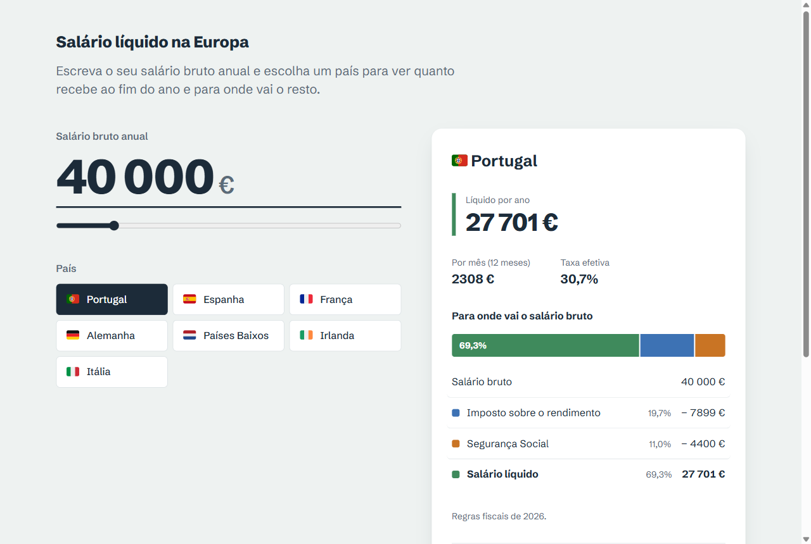

# Salário líquido na Europa

A single-page calculator that turns a **gross annual salary** into **net pay** for seven
European countries, and shows where the rest goes: income tax, social security and
other taxes. The interface is in Portuguese (pt-PT).

**Live demo:** [calculator-eu.netlify.app](https://calculator-eu.netlify.app/) · **Code:** [github.com/ingridmpg/calculator-eu](https://github.com/ingridmpg/calculator-eu)



## What it does

- Type a gross annual salary (or drag the slider) and pick a country. The result updates as you type.
- See the net annual and monthly amount, the effective tax rate, and a bar that splits the gross salary into its parts.
- Each line of the breakdown shows its share of gross. Hovering the bar highlights the matching line, and vice versa.
- "Notas e fontes" lists each country's special cases and links to the official sources behind the numbers.

## Countries

| Country | Reference | Tax rules | Includes |
|---|---|---|---|
| 🇵🇹 Portugal | — | 2026 | IRS, social security 11%, minimum-existence rule, solidarity surcharge |
| 🇪🇸 Spain | Madrid | 2026 | State + Madrid IRPF, social security up to the ceiling, solidarity contribution |
| 🇫🇷 France | — | 2026 contributions, 2026 tax scale (2025 income) | CSG/CRDS, pensions, income tax with décote |
| 🇩🇪 Germany | — | 2026 | § 32a EStG, solidarity surcharge, social insurance with ceilings |
| 🇳🇱 Netherlands | — | 2026 | Box 1 (incl. national insurance), general and labour tax credits |
| 🇮🇪 Ireland | — | 2026 | Income tax, USC, PRSI (with the October 2026 rate change) |
| 🇮🇹 Italy | Milan | 2026 | IRPEF, INPS, Lombardia and Milan surcharges |

Belgium is planned for v2, once its 2026 values are officially published.

## Assumptions

Every result uses the same taxpayer profile, which the app states on screen:

- Single, no dependants.
- Employee, tax resident in the chosen country.
- No special regimes (e.g. IRS Jovem in Portugal, the Beckham law in Spain, the 30% ruling in the Netherlands).
- No church tax. Regional and local taxes use a named reference city.
- The **final annual tax**, not the monthly withholding on a payslip.

These are simplified estimates. They do not replace an official simulator.

## Accuracy

Each country is unit-tested against at least two reference salaries (usually €30,000 and
€60,000). The expected values come from public calculators or hand calculations from the
official rules. Most match to the euro or the cent. Where they differ (e.g. German
calculators show monthly withholding), the gap is explained. The full validation table,
with sources, is in [PLAN.md](PLAN.md#validation).

## How it works

All calculations run in the browser; there is no backend.

```
src/
  data/countries/   one file per country: rates, thresholds and a pure computeTaxes(gross)
  lib/              calculateSalary(), progressiveTax(), formatting, salary parts
  i18n/             every UI string (pt-PT), ready for an English version
  components/       SalaryInput, CountryPicker, ResultPanel, SalarySplitBar, Breakdown, CountryNotes
  styles/           global CSS tokens; components use CSS Modules
```

- **One tax model per country.** Tax systems differ too much for one shared schema (Portugal's
  minimum-existence rule, Ireland's PRSI credit, Italy's local surcharges). So each country
  owns a small pure function built from shared helpers. Every rate is a named constant with
  its legal reference.
- **Pure functions.** `calculateSalary(gross, taxModel)` returns gross, income tax, social
  security, other taxes, net, monthly net and effective rate. That makes each country easy to test.
- **Adding a country** means one data file, one test file and one entry in `src/data/countries/index.ts`.

## Tech stack

- [React](https://react.dev/) + [TypeScript](https://www.typescriptlang.org/), built with [Vite](https://vite.dev/).
- Plain CSS with CSS Modules, no UI framework. Self-hosted [Schibsted Grotesk](https://fontsource.org/fonts/schibsted-grotesk) font.
- [Vitest](https://vitest.dev/) for unit tests, [oxlint](https://oxc.rs/) for linting.
- GitHub Actions runs lint, tests and build on every pull request.
- Flag emojis on Windows via [country-flag-emoji-polyfill](https://github.com/talkjs/country-flag-emoji-polyfill), with the font served by the app itself.

## Getting started

Requires Node.js 24.

```sh
npm install
npm run dev      # start the dev server
npm test         # run the unit tests
npm run lint     # lint
npm run build    # production build in dist/
```

## Deploying

The app is a static site. `netlify.toml` sets the build command (`npm run build`) and the
publish folder (`dist`), so connecting the repository to Netlify is enough.

## Roadmap (v2)

- Total employer cost.
- Optional English interface.
- Belgium and more countries, including non-euro ones.
- 12 vs 14 monthly payments, shareable URL.

The full plan and decision log are in [PLAN.md](PLAN.md).
